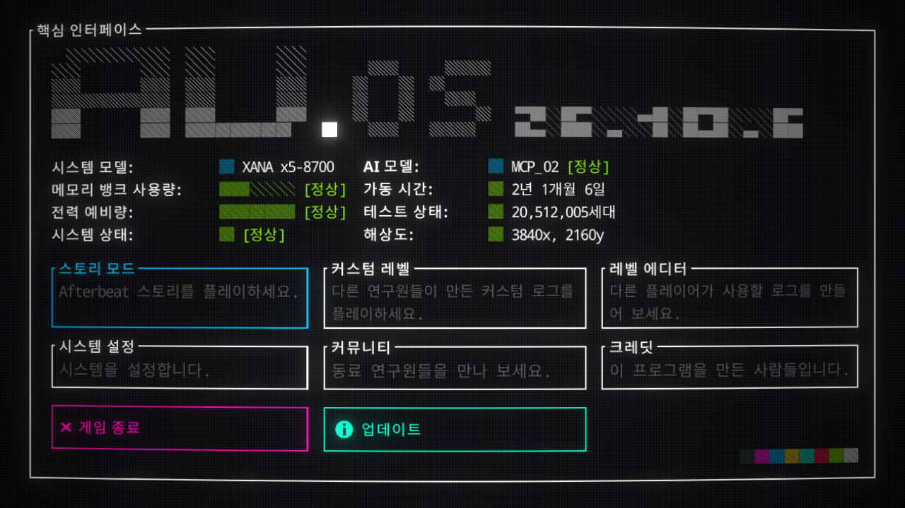

# Afterbeat 한글패치

Windows / Steam용 비공식 한국어 패치입니다. 메뉴, 스토리 대사, 기록·뉴스 문서, 에디터 UI 등 **2,112개 항목**을 번역했습니다. 게임의 기본 모드 로더와 내장 한글 폰트를 사용합니다.

**[최신 패치 다운로드](https://github.com/winter0729/afterbeat-korean/releases/latest)** · **[v1.2.0 ZIP 바로 받기](https://github.com/winter0729/afterbeat-korean/releases/download/v1.2.0/Afterbeat-Korean-1.2.0.zip)**



## v1.2.0 문맥 교정

v1.1.0 대비 **140개 항목**(대사 135개, 문서 5개)을 수정했습니다. 대사를 장면 순서대로 읽고 화자, 그 시점에 알고 있는 정보, 표정 연출과 앞뒤 응답을 대조했습니다.

- 정체를 고백하는 망설임, 남은 시간을 둘러싼 갈등, 선택을 앞둔 원망과 작별의 말을 자연스럽게 이었습니다.
- 혼잣말과 상대에게 하는 말을 구별하고, 문장만 보면 되묻는 말처럼 읽히던 알림·반문을 교정했습니다.
- 뒤의 응수와 연결되는 농담, 글리치의 반복과 중단, 표정·음악 명령과 선택 분기를 유지했습니다.
- 이야기의 단서인 저장소 오류 설명을 번역하고, 냉동 수면·철수 기록의 뜻을 바로잡았습니다. 암호문과 시스템 식별자는 유지합니다.
- 기존 폰트, 동적 UI 번역과 언어 전환 보완을 포함합니다.

## 설치

1. Afterbeat를 종료합니다.
2. 위 다운로드 페이지의 **Assets → `Afterbeat-Korean-1.2.0.zip`**을 받습니다.
3. Steam 라이브러리에서 **Afterbeat 우클릭 → 관리 → 로컬 파일 보기**로 게임 폴더를 엽니다.
4. ZIP 안의 **`Mods` 폴더**를 `Afterbeat.exe`가 있는 폴더에 복사합니다. 기존 패치를 업데이트할 때는 같은 이름의 패치 파일을 덮어씁니다.
5. Steam에서 **플레이**를 누릅니다. 처음 설치하면 한국어가 선택됩니다.

설치 후 파일 위치는 다음과 같아야 합니다.

```text
Afterbeat/
├── Afterbeat.exe
└── Mods/
    └── KoreanLocalization/
        ├── KoreanLocalization.Mod.dll
        ├── mod.json
        ├── translations.json
        └── README.md
```

게임 실행 파일이나 원본 DLL을 교체할 필요는 없습니다. 세이브 파일도 패치에 포함되어 있지 않습니다. 별도 모드 로더나 폰트를 설치하지 않아도 됩니다.

## 언어 변경 · 삭제

- 게임 설정의 **Video / Language**에서 언어를 변경할 수 있습니다. 모드는 마지막 선택을 기억합니다.
- 한국어 선택을 초기화하려면 게임을 종료하고 `Mods/KoreanLocalization/activated.txt`만 삭제한 뒤 다시 실행합니다.
- 패치를 끄려면 게임을 종료하고 `KoreanLocalization` 폴더를 `KoreanLocalization.disabled`로 이름을 바꿉니다. 완전히 삭제하려면 이 모드 폴더만 삭제합니다.

## 호환 버전과 검증

**Windows Steam 빌드 `25787377` / 게임 표시 버전 `26.10.6` / Unity `2021.3.45f2`**에서 확인했습니다. 다른 버전과 운영체제는 검증하지 않았습니다.

확인한 항목:

- Steam 라이브러리에서 실행 및 한국어 초기화
- 번역 테이블 6개의 837개 항목, 영어 원문과 Smart String 메타데이터 보존
- Ink 스크립트 37개 파싱, 기록·뉴스 문서 65개의 식별자와 잠금 조건 보존
- Ink 원문·번역본 실행 대조: 1,536개 조건 조합과 1,760개 선택 경로에서 화자·감정 태그, 선택지 목적지, 외부 명령 인수 일치(게임 동작은 기록만 하는 검사)
- 영어·한국어 전환, 사용된 한글 완성형 811자의 폰트 수록 및 단독 자음 렌더링
- 시작 안내 화면과 메인 메뉴의 한글 표시

전체 스토리 분기를 직접 플레이한 검수는 하지 않았습니다. 이미지 속 글자, 음성, Steam 화면, 사용자 제작 레벨 내용은 번역 대상에 포함되지 않습니다. 일부 동적 에디터 문구와 구형 UI에는 영어가 남을 수 있습니다.

게임 업데이트 뒤 문제가 생기면 모드를 비활성화하고 [Issues](https://github.com/winter0729/afterbeat-korean/issues)에 게임 버전과 문제가 발생한 화면을 알려 주세요.

## 번역 범위

| 구분 | 검토한 원문 항목 |
| --- | ---: |
| 기본 번역 테이블 | 837 |
| 대사 스크립트의 문자열 후보 | 594 |
| 기록·뉴스 문서 | 65 |
| 레거시 UI | 144 |
| 장면 UI | 573 |
| 코드의 UI 문자열 후보 | 226 |

총 2,439개 항목을 검토하고 2,112개를 변경했습니다. 고유명사, 식별자, 조작 키, 공백 등은 필요에 따라 원문을 유지했습니다. 번역은 GPT 6 Luna 서브에이전트가 작성하고 교차 검수했습니다. 원문을 유지한 항목에는 암호화된 단서와 음악 재생 식별자도 포함됩니다.

## 소스와 번역 수정

런타임 번역 데이터는 [`Mods/KoreanLocalization/translations.json`](Mods/KoreanLocalization/translations.json)에 있습니다. 수정할 때는 문자열 ID, Ink 명령과 분기, 변수, 서식 태그, UI 경로를 유지하세요. 번역 파일만 수정했다면 게임을 다시 실행하면 반영됩니다.

모드 소스는 [`Mods/_KoreanLocalizationSource`](Mods/_KoreanLocalizationSource)에 있습니다. 직접 빌드하려면 .NET SDK가 필요합니다.

1. 이 저장소의 `Mods/KoreanLocalization`과 `Mods/_KoreanLocalizationSource`를 게임의 `Mods` 폴더에 복사합니다.
2. 게임 폴더에서 PowerShell을 열고 다음 명령을 실행합니다.

```powershell
& .\Mods\_KoreanLocalizationSource\build.ps1
```

빌드 스크립트는 설치된 게임의 `Afterbeat_Data/Managed` 라이브러리를 참조하여 `Mods/KoreanLocalization/KoreanLocalization.Mod.dll`을 생성합니다. 게임 원본 라이브러리와 폰트는 이 저장소에 포함하지 않습니다.

Afterbeat와 게임 원문·에셋의 권리는 각 권리자에게 있습니다. 이 패치는 게임 개발사의 공식 배포물이 아닙니다.
